<div align="center">

# CVForge

### Build your CV. Find your fit. Land the internship.

An Android app where students build a CV, discover internships and track every application,
while companies, teachers and alumni post internships, endorse skills and chat with students.


</div>

---

## Table of contents

1. [Overview](#-overview)
2. [Highlights](#-highlights)
3. [Roles](#-roles)
4. [Features](#-features)
5. [Screenshots](#-screenshots)
6. [Course Requirements Coverage](#-course-requirements-coverage)
7. [Tech stack](#-tech-stack)
8. [Architecture](#-architecture)
9. [Android components](#-android-components)
10. [Networking](#-networking)
11. [Firebase](#-firebase)
12. [How to run](#-how-to-run)
13. [Project structure](#-project-structure)
14. [Limitations and future work](#-limitations-and-future-work)
15. [Author](#-author)

---

## 🧭 Overview

Finding a first internship is hard. Students send the same CV everywhere, never hear back, and lose track of what they
applied for. Posters have the opposite problem: many applicants, fake posts, and no easy way to see who fits.

CVForge puts both sides in one app. A student builds a CV with a live preview, sees how well it matches each internship,
swipes through jobs, and follows every application on a Kanban board. Companies, teachers and alumni post internships,
review applicants, plan interviews and talk to students in chat. An admin verifies Company and Alumni accounts and reviews
suspicious posts.

**Everything is live.** Chat messages, the typing indicator, applications and the Tracker board update through Cloud Firestore
real-time listeners (`addSnapshotListener` in `ChatRepository`, `ApplicationRepository` and `MessageNotifier`), so a change
reaches the other user at once, without refreshing the screen. When a company moves an applicant to Interview, the card moves
on the student's Tracker board by itself.

---

## ✨ Highlights

| | | | |
|:--:|:--:|:--:|:--:|
| **28** activities | **10** fragments + 2 bottom sheets | **24** RecyclerView adapters | **7** custom views |
| **5** user roles | **80** XML layouts | **9** Firestore collections | **164** Java files |
| **4** job and code data sources | **6** Gemini helpers | **3** background workers | **3** CV templates |

---

## 👥 Roles

| Role | Signs up | What the role does |
|------|----------|--------------------|
| Student | Directly | Builds CVs, discovers and applies, tracks applications, practises interviews, asks for endorsements, books mentors |
| Company | Needs admin approval | Posts internships, reviews applicants, plans interviews, makes offers |
| Teacher | Directly | Posts internships, manages applicants, endorses student skills |
| Alumni | Needs admin approval | Posts opportunities, endorses skills, offers mentor slots |
| Admin | Role set by hand in Firestore | Approves Company and Alumni accounts, reviews flagged posts |

---

## 🚀 Features

### Student
- CV builder with three templates (Modern, Classic, Minimal), live preview, several CV versions, QR code, PDF export and sharing
- Import projects from a GitHub account
- Profile strength ring that tells what to improve
- Discover internships from CVForge posts and outside job feeds, with search, filters, swipe cards and bookmarks
- Match Radar and match ring: how well the CV fits the skills an internship asks for
- Apply with one tap and choose which CV version to send
- Kanban tracker with four columns (Saved, Applied, Interview, Offer): drag a card to change its status, add private notes,
  see the status timeline. Shortlisted and Rejected set by a company show on the card
- Reminders for deadlines and interviews, a morning digest, and interviews that can be added to the phone calendar
- Gemini helpers: bullet writer, Tailor my CV for one job, skill gap roadmap, interview coach (voice or typing), follow-up email draft
- Verified endorsements from teachers and alumni, mentor slots with alumni, badges and a day streak

### Company
- Dashboard with numbers and the latest applicants, a list of own postings with applicant counts, and a profile tab
- Post, edit, close and delete internships, with scam rule checks
- Applicants list with match ring and verified skills: shortlist, plan an interview, make an offer or reject

### Teacher
- Post internships and manage applicants
- Dashboard with numbers on own posts, and endorsement requests from students (endorse a skill with a comment)

### Alumni
- Post opportunities and manage applicants
- Endorse skills and add 30-minute mentor slots that students can book

### Admin
- Approve Company and Alumni accounts (Verified badge)
- Review flagged posts: rule reasons, an optional Gemini second opinion (SAFE, SUSPICIOUS or SCAM), then Keep or Remove

### For all roles
- **Live chat:** between student and company or teacher (per application) and between student and alumni (per booked slot),
  with typing dots, unread badges and chat message notifications
- **Profile photos:** compact 256 x 256 JPEG images stored as Base64 text in Cloud Firestore (`profilePhotos` collection)
  and cached in memory
- **Scam post alert:** rule checks when a post is created; flagged posts go to the admin
- **Ghosting detector:** an application with no reply for 7 days shows a nudge and a follow-up email draft
- **Offline banner and cache:** saved jobs and CVs open without internet

---

## 📱 Screenshots

<div align="center">
<table>
  <tr>
    <td align="center">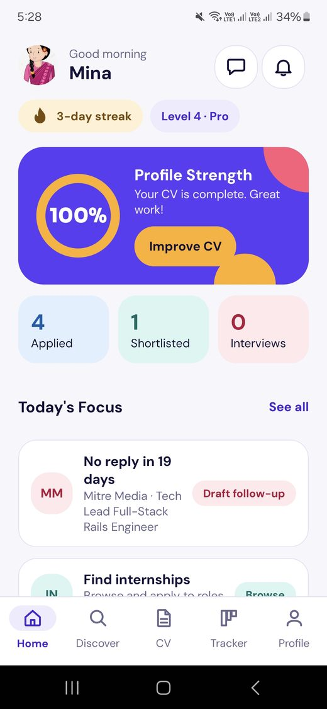<br><sub><b>Home</b><br>Today's Focus</sub></td>
    <td align="center">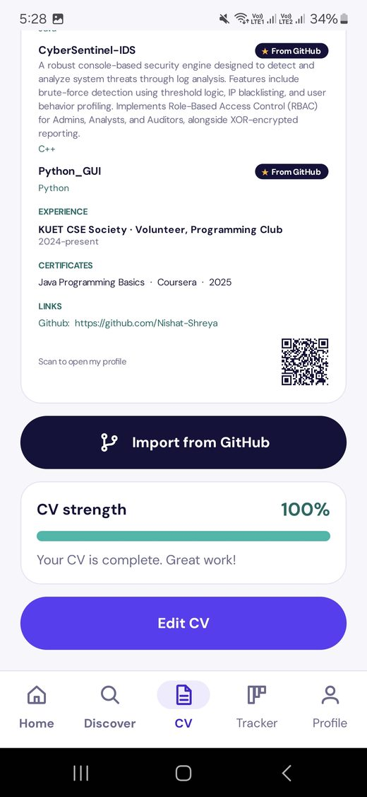<br><sub><b>CV Builder</b><br>Live preview</sub></td>
    <td align="center">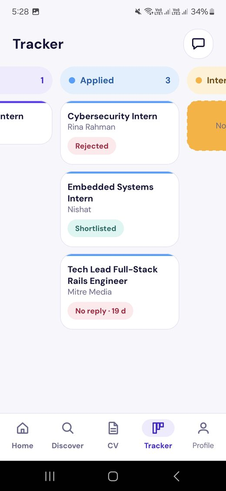<br><sub><b>Tracker</b><br>Kanban board</sub></td>
  </tr>
  <tr>
    <td align="center">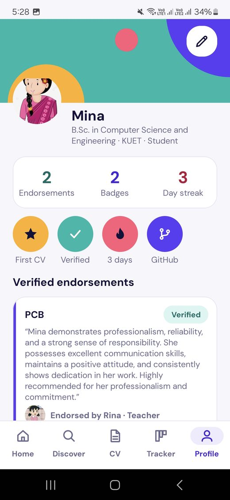<br><sub><b>Profile</b><br>Badges and endorsements</sub></td>
    <td align="center">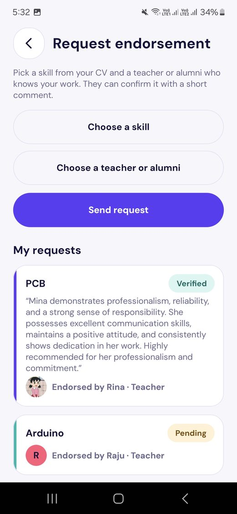<br><sub><b>Request endorsement</b><br>Ask a teacher or alumni</sub></td>
    <td align="center">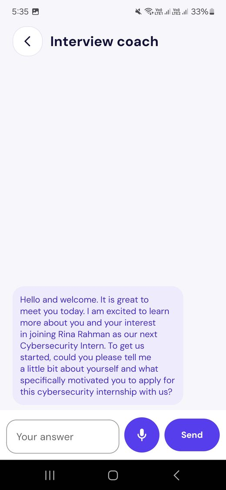<br><sub><b>Interview coach</b><br>Gemini practice</sub></td>
  </tr>
  <tr>
    <td align="center">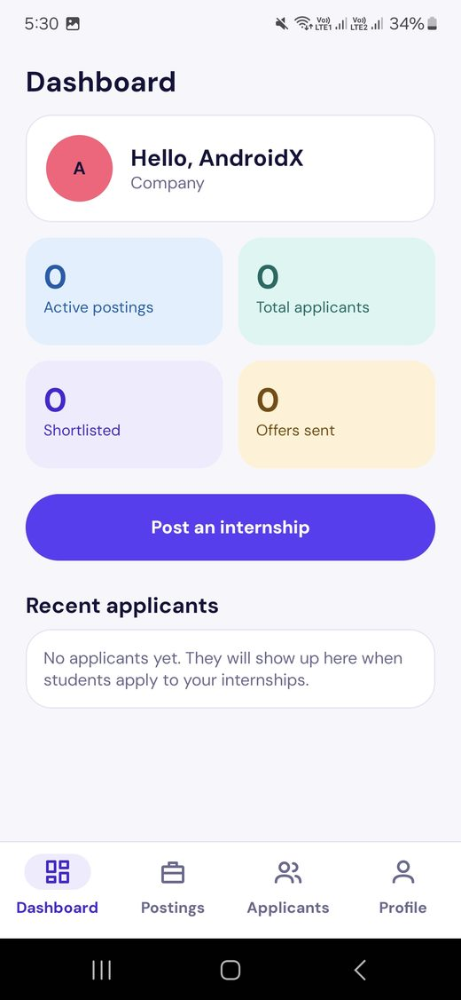<br><sub><b>Company dashboard</b><br>Numbers and latest applicants</sub></td>
    <td align="center">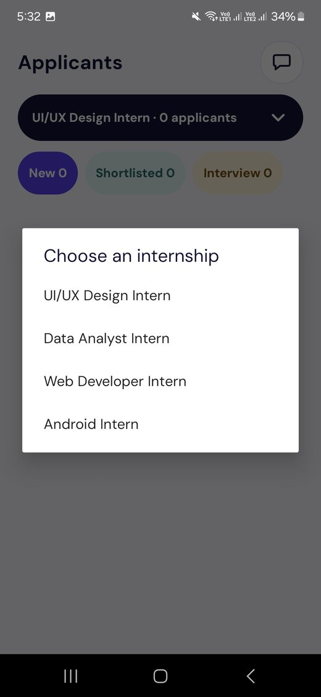<br><sub><b>Company applicants</b><br>Shortlist, interview, offer</sub></td>
    <td align="center">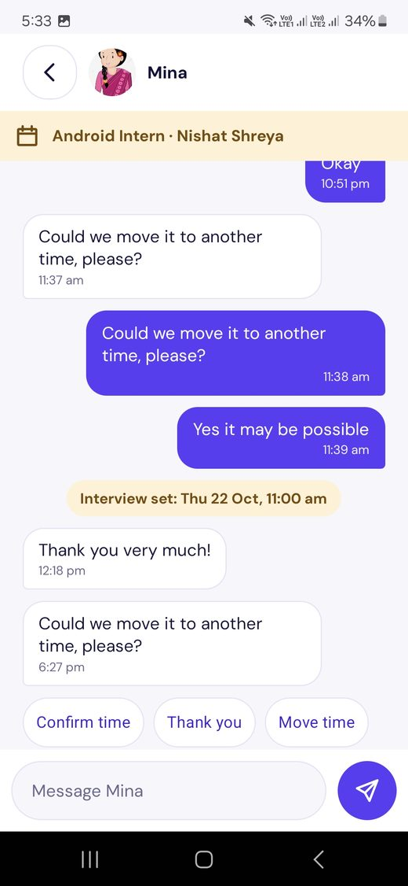<br><sub><b>Application chat</b><br>Live messages</sub></td>
  </tr>
</table>
</div>

---

## 🎓 Course Requirements Coverage

This section maps the topics of the Advanced Programming Laboratory to the code. In the last column, `...` means
`app/src/main/java/com/example/cvforge/`, and layouts are in `app/src/main/res/`. Counts are taken from the code in this repository.

<details>
<summary><b>Lab 8: Project, activities, intents, View Binding</b></summary>

| Requirement | What the project does | Where to find it |
|-------------|-----------------------|------------------|
| Android Studio project | One `app` module, Gradle (Groovy), 28 activities in the manifest, launcher is `WelcomeActivity` | `app/build.gradle`, `AndroidManifest.xml` |
| Activities and fragments | 28 activities, 10 fragments (one, `TitleFragment`, is no longer used) and 2 bottom sheets | `.../ui/*`, `FilterSheet`, `BulletWriterSheet` |
| Activity lifecycle | Draft CV saved in `onPause`; Firestore listeners and the network receiver start in `onStart` and stop in `onStop`; speech recognizer released in `onPause` | `CvEditorActivity`, `ApplicationDetailActivity`, `StudentActivity`, `CoachActivity` |
| Explicit intents | 51 `startActivity` calls with extras such as the internship id, CV id and application id; results with `ActivityResultLauncher` in 5 classes | `DiscoverFragment` to `InternshipDetailActivity`, `TrackerFragment` to `ApplicationDetailActivity`, `HomeFragment` to `AllFocusActivity` |
| Implicit intents | `ACTION_VIEW` (job link), `ACTION_SENDTO` (follow-up email), `ACTION_SEND` with chooser (CV PDF), `ACTION_INSERT` (calendar event), `ACTION_RECOGNIZE_SPEECH`, image picker (`GetContent`), exact-alarm settings screen | `ApplyFlow`, `FollowUpEmail`, `ShareHelper`, `CalendarHelper`, `BookSlotActivity`, `CoachActivity`, `ProfilePhoto`, `ExactAlarmPermission` |
| View Binding | Enabled with `buildFeatures.viewBinding`; 64 classes use binding classes. `findViewById` appears 8 times, only to read a view inside a binding (chip groups, chat and coach holders) | `app/build.gradle`, `.../ui/*` |
| XML layouts | 80 layouts plus 1 landscape layout; 9 reusable `include_*` layouts, used by 35 layout files | `res/layout`, `res/layout-land/activity_welcome.xml` |
| Click listeners | Set in code on binding fields, for example `binding.btnApply.setOnClickListener` | `InternshipDetailActivity` and the other screens |

</details>

<details>
<summary><b>Lab 9: RecyclerView, adapters, custom views</b></summary>

| Requirement | What the project does | Where to find it |
|-------------|-----------------------|------------------|
| RecyclerView and adapters | 24 adapter classes plus the abstract base `EditableListAdapter`; one adapter is an inner class | `.../ui/discover/InternshipAdapter`, `.../ui/tracker/CardAdapter`, `.../ui/post/ApplicantAdapter` and more |
| ViewHolders | Every adapter has a `ViewHolder` class that holds a binding class | all adapters |
| Several view types | `MessageAdapter` has 3 types (sent, received, system notice); `CoachAdapter` has 2 (coach, student) | `.../ui/chat/MessageAdapter`, `.../ui/coach/CoachAdapter` |
| Nested lists | The Kanban board is a horizontal list of columns, and each column has its own list of cards | `KanbanAdapter`, `CardAdapter` in `.../ui/tracker` |
| Custom item layouts | One item layout per adapter, for example `item_internship.xml`, `item_kanban_card.xml`, `item_message_sent.xml` | `res/layout/item_*.xml` |
| Custom views | 7 views: `ProfileStrengthRing`, `MatchRadarView`, `BottomNavView`, `ConfettiView`, `CircleDecorationView`, `CvPreviewView`, `SwipeCardView`. `CardDragShadow` is a drag shadow builder, not a view | `.../ui/view`, `.../ui/cv/CvPreviewView`, `.../ui/discover/SwipeCardView` |
| UX states | Loading indicators, an empty-state include and error messages on the list screens | `res/layout/include_empty_state.xml`, `.../ui/*` |

</details>

<details>
<summary><b>Lab 10: Services, receivers, providers, permissions</b></summary>

| Requirement | What the project does | Where to find it |
|-------------|-----------------------|------------------|
| Service | Started service `JobSyncService` (started with `startService`, not bound, not foreground). `onCreate`, `onStartCommand` and `onDestroy` are logged under the tag `JobSyncService`, and it sends a broadcast when it is done. `CvForgeMessagingService` is the Firebase messaging service | `.../service/JobSyncService`, `.../service/CvForgeMessagingService` |
| Receivers in the manifest | `BootReceiver` (boot and app update, sets reminders again) and `ReminderReceiver` (alarm fires, shows a notification) | `.../receiver`, `AndroidManifest.xml` |
| Receivers in code | `NetworkReceiver` (offline banner, registered in `onStart`, unregistered in `onStop`) and a jobs-synced receiver in `DiscoverFragment` | `StudentActivity`, `DiscoverFragment` |
| Own ContentProvider | `CvProvider` with the paths `bookmarks` (query, insert, delete) and `cv_drafts` (query only). The app uses `bookmarks` through `ContentResolver` | `.../provider/CvProvider`, `CvContract`, `.../data/BookmarkRepository` |
| FileProvider | Shares the exported CV PDF with other apps | `res/xml/file_paths.xml`, `.../util/ShareHelper` |
| System provider | `CalendarContract`: query calendars, insert events and reminders | `.../util/CalendarHelper` |
| Runtime permissions | `POST_NOTIFICATIONS` in `NotificationPermission`; `READ_CALENDAR` and `WRITE_CALENDAR` in `ApplicationDetailActivity` and `CalendarHelper`; `RECORD_AUDIO` in `CoachActivity`. The exact-alarm permission is granted on a settings screen | `.../util`, `.../ui/tracker`, `.../ui/coach` |
| Component communication | Service to fragment by broadcast; AlarmManager to receiver by `PendingIntent`; notifications open `WelcomeActivity` with a `target` extra | `JobSyncService`, `ReminderScheduler`, `NotificationHelper` |
| Background work | WorkManager: `ReminderWorker`, `DigestWorker`, `GhostingWorker`; AlarmManager for exact reminders | `.../service`, `.../util/ReminderScheduler` |

</details>

<details>
<summary><b>Lab 11: Networking, JSON, XML, Firebase</b></summary>

| Requirement | What the project does | Where to find it |
|-------------|-----------------------|------------------|
| HTTP and Retrofit | Retrofit with a logging interceptor: Remotive and Arbeitnow job APIs and the GitHub repositories API | `.../network/ApiClient`, `RemotiveApi`, `ArbeitnowApi`, `GithubApi` |
| JSON | Gson converts the API answers into model classes. Gson also stores the CV sections as JSON in Room | `.../network/model`, `.../data/local/CvEntity` |
| XML parsing | The We Work Remotely RSS feed is read with `HttpURLConnection` and parsed with `XmlPullParser`; a sample XML file is the fallback | `.../network/RssFeedLoader`, `RssJobParser`, `res/raw/sample_jobs.xml` |
| Local database | Room database version 3 with 2 migrations: tables `cvs`, `bookmarks` and `jobs`, with DAOs, used on a background executor | `.../data/local` |
| Firebase Authentication | Email/password and Google sign-in (Credential Manager) | `.../data/UserRepository`, `.../ui/auth/GoogleSignInHelper` |
| Cloud Firestore | Nine collections (see [Firebase](#-firebase)) with real-time listeners for chat, typing, applications and the Tracker | `.../data/*Repository`, `.../service/MessageNotifier` |
| Profile photos | 256 x 256 JPEG, Base64 text in the `profilePhotos` collection, cached in memory | `.../util/ProfilePhoto`, `.../data/UserRepository` |
| Other Firebase services | Cloud Messaging service (token saved in the user document), Firebase AI Logic (Gemini), App Check (Play Integrity in release, debug provider in debug) | `.../ai/AiRepository`, `AppCheckSetup` in `src/debug` and `src/release` |

</details>

---

## 🧰 Tech stack

| Area | Used |
|------|------|
| Language | Java |
| UI | XML layouts, View Binding, reusable `<include>` layouts, Material Components |
| Lists | RecyclerView with adapters and view holders (two or three view types in the chat and the coach) |
| Custom views | `SwipeCardView`, `MatchRadarView`, `ProfileStrengthRing`, `CvPreviewView`, `BottomNavView`, `ConfettiView`, `CircleDecorationView` |
| Local data | Room (CVs, bookmarks, cached jobs), SharedPreferences |
| Networking | Retrofit + Gson, OkHttp logging, `HttpURLConnection` + `XmlPullParser` for the RSS feed |
| Background work | Started Service, WorkManager (reminders, digest, ghosting), AlarmManager (exact reminders) |
| Firebase | Authentication (email/password and Google), Cloud Firestore, Cloud Messaging, Firebase AI Logic, App Check |
| AI | Gemini through Firebase AI Logic, model `gemini-3.5-flash-lite` (`AiRepository.MODEL_NAME`) |
| Other | ZXing (QR code), Android `PdfDocument`, `SpeechRecognizer`, `CalendarContract`, Credential Manager (Google sign-in) |
| Android versions | `minSdk 23`, `targetSdk 32`, `compileSdk 34` |
| Build | Android Gradle Plugin 7.2.0, Gradle 7.3.3 (Groovy build files), Java 8 source level |
| Library versions | Firebase BoM 33.14.0, Room 2.4.3, Retrofit 2.9.0, Gson 2.9.1, WorkManager 2.7.1, ZXing core 3.5.1, Material 1.6.1, AppCompat 1.5.1 |
| Tests | JUnit unit tests for the scam rules, match score, filters, parsers, mappers, reminder and digest planners and application status logic |

---

## 🏗 Architecture

<div align="center">
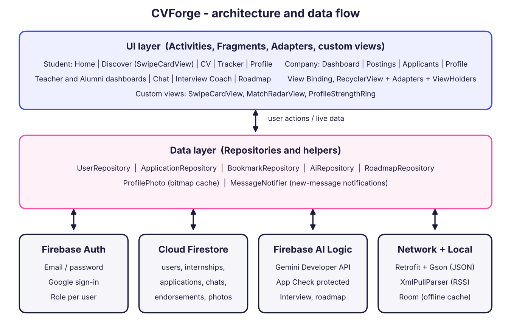
</div>

The app has three simple layers:

- **UI layer** (`ui`): Activities, Fragments, adapters and custom views. Screens show data and react to taps.
- **Repository layer** (`data`): one repository per topic (users, CVs, internships, applications, chat, endorsements,
  mentor slots, jobs). Screens talk to repositories and never to Firestore or Room directly.
- **Data sources**: remote (Cloud Firestore, Firebase Auth, Retrofit APIs, the RSS feed, Gemini) and local (Room and SharedPreferences).
  Jobs and CVs are cached in Room, so saved data opens without internet.

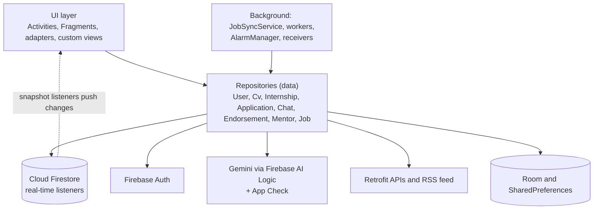

### Live updates through Cloud Firestore listeners

Chat messages (`ChatRepository.listenMessages`), the typing indicator (`listenTyping`), the chat list and its unread badge
(`listenMyChats`), the student's Tracker board (`ApplicationRepository.listen`), the company's applicants
(`listenByPoster`) and one application's timeline (`listenOne`) all use `addSnapshotListener`. `MessageNotifier` uses the
same kind of listener to show chat notifications. Listeners start when a screen becomes visible and stop when it goes away.

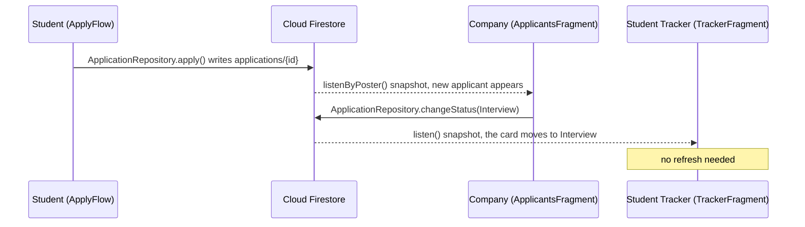

---

## 🧩 Android components

<details>
<summary><b>Service, receivers, providers and workers</b></summary>

| Type | Component | What it does |
|------|-----------|--------------|
| Service (started) | `JobSyncService` | Loads jobs from the outside feeds into Room, logs its lifecycle, sends a broadcast when it is done |
| Service (Firebase) | `CvForgeMessagingService` | Receives push messages and saves the FCM token |
| Receiver (manifest) | `BootReceiver` | After a restart or an app update, sets the reminder alarms again |
| Receiver (manifest) | `ReminderReceiver` | Shows the interview or deadline notification when an alarm fires |
| Receiver (in code) | `NetworkReceiver` | Shows the offline banner on the student screen |
| Receiver (in code) | jobs-synced receiver in `DiscoverFragment` | Refreshes the job list when `JobSyncService` finishes |
| Workers | `ReminderWorker`, `DigestWorker`, `GhostingWorker` | Reminders every 6 hours, a daily morning digest, a daily ghosting check |
| ContentProvider (own) | `CvProvider` | Gives access to bookmarks and CV drafts (`bookmarks` and `cv_drafts` paths) |
| FileProvider | `androidx.core.content.FileProvider` | Shares the exported CV PDF with other apps |
| Other providers used | `CalendarContract`, `MediaStore` | Add an interview to the calendar, read the photo orientation |

</details>

<details>
<summary><b>Permissions and why each is needed</b></summary>

| Permission | Why |
|------------|-----|
| `INTERNET` | Firebase, job APIs, GitHub, RSS feed |
| `ACCESS_NETWORK_STATE` | Offline banner |
| `POST_NOTIFICATIONS` | Notifications (asked at runtime on Android 13+) |
| `SCHEDULE_EXACT_ALARM` | Interview and deadline reminders at the exact time |
| `RECEIVE_BOOT_COMPLETED` | Set reminders again after a restart |
| `READ_CALENDAR`, `WRITE_CALENDAR` | Add an interview to the phone calendar (asked at runtime) |
| `RECORD_AUDIO` | Speak the answer in the interview coach (asked at runtime, typing also works) |

</details>

---

## 🌐 Networking

<details>
<summary><b>External APIs and feeds</b></summary>

| API or feed | Method and URL | Used in |
|-------------|----------------|---------|
| Remotive | `GET https://remotive.com/api/remote-jobs` (search `intern`, limit 30) | Discover |
| Arbeitnow | `GET https://www.arbeitnow.com/api/job-board-api` | Discover |
| We Work Remotely (RSS, parsed with `XmlPullParser`) | `GET https://weworkremotely.com/categories/remote-programming-jobs.rss` | Discover |
| GitHub | `GET https://api.github.com/users/{user}/repos` (sorted by update, 30 per page) | Import projects in the CV editor |

</details>

None of these four needs an API key in the code. The GitHub API allows 60 requests per hour without a key.
Gemini is called through Firebase AI Logic, so no key is stored in the app.

---

## 🔥 Firebase

- **Authentication:** email/password and Google sign-in.
- **Cloud Firestore:** all live data, with real-time listeners (see [Architecture](#-architecture)).
- **Cloud Messaging:** `CvForgeMessagingService` receives push messages and saves the FCM token in the user document.
- **Firebase AI Logic (Gemini):** bullet writer, Tailor my CV, skill gap roadmap, interview coach, follow-up emails and the scam second opinion.
- **App Check:** protects the AI calls (Play Integrity in release builds, a debug provider in debug builds).

<details>
<summary><b>Cloud Firestore collections</b></summary>

| Collection | Purpose |
|------------|---------|
| `users` | Name, role, verified flag, FCM token |
| `profilePhotos` | Profile photo of each user: 256 x 256 JPEG as Base64 text |
| `internships` | Posts, with scam flag and reasons |
| `applications` | One per student and internship: status, status history, CV copy, interview time |
| `applicationNotes` | Private notes of the student |
| `cvs` | CV versions of each student |
| `endorsements` | Skill endorsement requests and approvals |
| `mentorSlots` | Alumni slots and bookings |
| `chats` (with `messages` sub-collection) | Conversations, typing state and messages |

</details>

### Firebase console

<div align="center">
<table>
  <tr>
    <td align="center">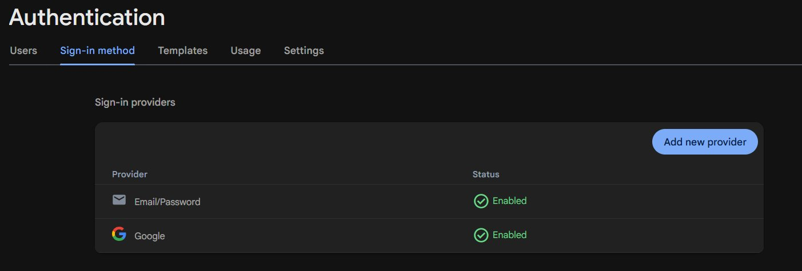<br><sub><b>Authentication providers</b></sub></td>
    <td align="center">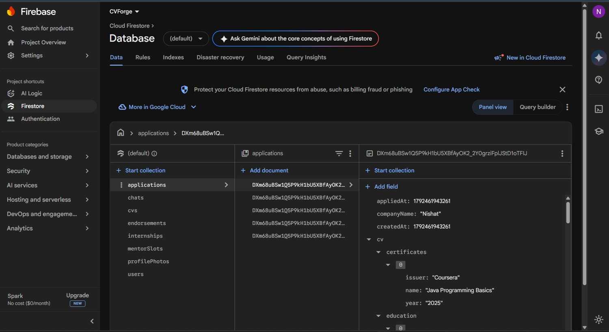<br><sub><b>Firestore data</b></sub></td>
  </tr>
  <tr>
    <td align="center">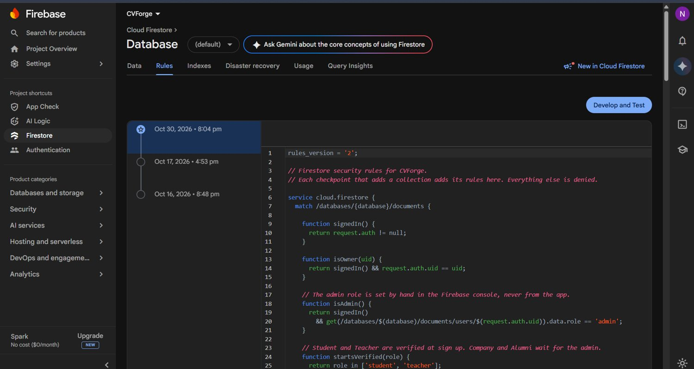<br><sub><b>Firestore security rules</b></sub></td>
    <td align="center">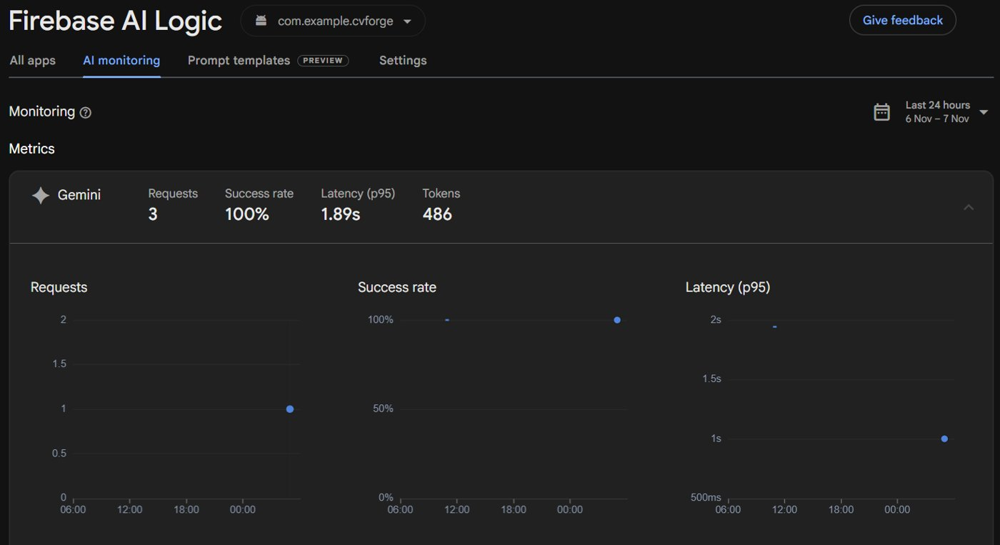<br><sub><b>Firebase AI Logic monitoring</b></sub></td>
  </tr>
  <tr>
    <td align="center" colspan="2">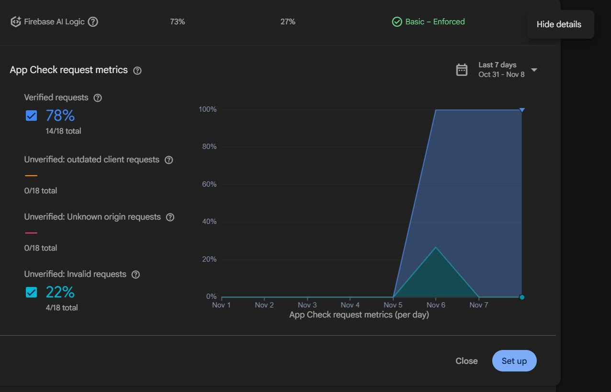<br><sub><b>App Check metrics</b></sub></td>
  </tr>
</table>
</div>

---

## 🏁 How to run

**You need:** Android Studio Chipmunk (2021.2.1) or newer with its bundled JDK 11, an internet connection, and a Google account for Firebase.
The project uses Android Gradle Plugin 7.2.0 and Gradle 7.3.3 (the wrapper downloads Gradle by itself).

1. Clone the repository and open the folder in Android Studio. Android Studio creates `local.properties` (the SDK path) by itself.
2. Create your own Firebase project and register an Android app with the package name `com.example.cvforge`.
3. Download `google-services.json` and put it in the `app/` folder. It is not in the repository, because it belongs to one Firebase project.
4. In the Firebase console turn on:
   - **Authentication**: Email/Password and Google
   - **Cloud Firestore**: create the database
   - **Firebase AI Logic**: Gemini Developer API (no key is added to the app)
   - **App Check**: register the app. For debug builds, run the app once, copy the debug token shown in Logcat and add it under *Manage debug tokens*.
5. For Google sign-in add the **SHA-1 and SHA-256** of your debug keystore (Gradle `signingReport`) to the Android app in Firebase, then download `google-services.json` again.
6. Set the Firestore security rules (see below), then build and run on a device or emulator with Android 6.0 or newer.
7. To try the admin screen, set `role` to `admin` by hand on one document of the `users` collection.

**Firestore rules are not in the repository.** Create your own in the Firebase console (Firestore, Rules tab). A simple safe plan:
only signed-in users can read or write; a user can write only his or her own `users`, `profilePhotos`, `cvs` and `applicationNotes`
documents; `internships` can be created only by verified posters; `applications`, `endorsements` and `mentorSlots` can be changed
only by the people they belong to; `chats` and their `messages` can be read and written only by the two participants.
Test the rules in the Rules Playground before you publish them.

**Push notifications.** Notifications while the app is fully closed need Cloud Functions, which need the paid Firebase plan.
The `functions/` folder has two functions (status change and chat message), written for Node.js 20, but they are not deployed.
Local reminders, the morning digest and in-app chat notifications while the app is running work without them.

---

## 📂 Project structure

```
app/src/main/java/com/example/cvforge/
├── ai/         Gemini calls and prompts (bullets, tailor CV, roadmap, coach, scam review)
├── data/       Repositories; local/ has the Room database, model/ has the data classes
├── network/    Retrofit APIs, RSS parser and loader, job mapper
├── provider/   CvProvider (own ContentProvider) and its contract
├── receiver/   BootReceiver, ReminderReceiver, NetworkReceiver
├── service/    JobSyncService, FCM service, workers, chat notifier
├── ui/         Screens, one package per feature
│   ├── admin, alumni, auth, company, teacher   (one per role and sign-in)
│   ├── student, cv, discover, tracker          (student tabs and CV editor)
│   ├── post, profile, chat, coach              (postings, endorsements, mentors, chat, interview coach)
│   └── view/   Custom views
└── util/       Helpers: PDF, QR, match score, scam rules, reminders, profile photo
```

---

## 🔭 Limitations and future work

- Notifications while the app is fully closed need Cloud Functions on the paid plan. The functions are written in `functions/` but not deployed.
- The QR code points to a public profile page (`cvforge-93934.web.app/u/<uid>`) that is not hosted yet.
- There are unit tests for rules, parsers and planners, but no automatic UI tests yet.
- Future ideas: a public profile web page, CV import from a file, more job feeds, and a tablet layout.

---

## 👤 Author

**Nishat Tasin Shreya**
Roll 2307035 · Batch 2K22
Department of Computer Science and Engineering
Khulna University of Engineering & Technology (KUET)

Course teachers:
- Safin Ahmmed, Assistant Professor
- Ehsanul Karim Talha, Lecturer
